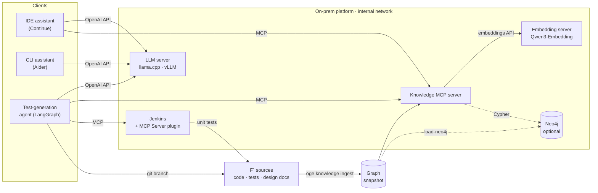

# onprem-genai-embedded

**A reference implementation of an on-premise GenAI platform for embedded / aerospace software teams —
sized, benchmarked and air-gap verified, with a requirements-aware code knowledge graph exposed to assistants
over MCP.**

[Français](README.fr.md) · [Architecture](docs/ARCHITECTURE.md) · [Design decisions](docs/DESIGN_DECISIONS.md) ·
[Agent](docs/AGENT.md) · [Evaluation suite](docs/EVALSUITE.md) · [Results](docs/results/README.md) ·
[Plan](docs/PLAN.md)

Target code base: **NASA F´ (F Prime) v4.4.1** — JPL's open-source flight-software framework (flown on the
Ingenuity Mars helicopter), Apache-2.0, ≈ 207 k lines of C++. Fetched at a pinned commit, never vendored.

---

## What it does

| Layer | Component | Status |
|---|---|---|
| **Sizing** | `oge sizing` — GPU memory (weights + KV cache + linear-attention state), roofline throughput incl. MoE expert traffic, team capacity planning; every datasheet value carries its source, unknown values are refused, not guessed | ✅ calibrated on Kaggle runs (pending) |
| **Serving** | llama.cpp (CPU / CUDA) and vLLM profiles in Docker Compose, API keys, localhost-bound ports; `oge bench` load generator (TTFT, TPOT, throughput percentiles) with code-assistant traffic profiles | ✅ stack · ⏳ 2×T4 measurements |
| **Knowledge** | Tree-sitter ingestion of code, unit tests, requirement tables and design docs into a typed graph (in-memory or **Neo4j**); hybrid BM25 + dense + graph retrieval | ✅ |
| **MCP** | Knowledge server (MCP SDK v2, stdio or streamable HTTP): `search`, `get_symbol`, `get_callers/callees`, `get_requirement`, `trace_requirement`, `coverage_gaps`, `module_overview` | ✅ |
| **Assistants** | Continue, Aider and generic MCP client configs targeting the platform | ✅ |
| **Air gap** | Compose overlay on an internal Docker network + smoke test that **fails if any outbound connection succeeds** | ✅ (CI) |
| **Model evaluation** | `oge eval` — 27 purpose-written embedded C tasks (generation, unit-test generation, refactoring, documentation) scored by execution: strict compile, hidden tests, ASan/UBSan, gcov coverage, mutation testing, complexity, Doxygen completeness; the suite validates itself | ✅ suite · ⏳ model runs |
| **Agent** | `oge agent` — LangGraph agent that closes F´ traceability gaps: retrieves context over MCP, writes a requirement-tagged unit test, builds and runs it, repairs from compiler and test output, commits on a review branch; the model only writes test code, everything else is deterministic and policy-checked | ✅ end to end on F´ (scripted model) · ⏳ model runs |
| **CI** | Jenkins LTS with the official MCP Server plugin (least-privilege service account, JCasC); the agent triggers the F´ unit-test pipeline and reads the verdict over MCP | ✅ (CI) |

## Results so far

### Requirement → test traceability recovery (F´)

Ground truth: the 481 `REQUIREMENT("ID")` tags F´ developers placed in unit tests, linking **151 requirements**
to the tests that verify them. Tags and IDs are masked; each method ranks **all 3,261 test cases** of the code
base for every requirement. Mean over requirements, 95 % bootstrap CI.

| Method | MAP | MRR | Recall@1 | Recall@10 |
|---|---|---|---|---|
| Graph only (requirement's module, call edges) | 0.249 [0.220, 0.278] | 0.291 | 0.073 | 0.550 |
| BM25 over code (identifier-aware tokenizer) | 0.488 [0.427, 0.548] | 0.591 | 0.297 | 0.677 |
| **Graph-constrained BM25 (hybrid)** | **0.569 [0.513, 0.626]** | **0.665** | **0.330** | **0.781** |
| + dense (Qwen3-Embedding-0.6B), + LLM rerank | ⏳ `kaggle/01_m1_benchmark` | | | |

Neither signal alone is enough: the graph knows *where* to look (requirements are allocated to components),
the text knows *which* test. Source: [`docs/results/traceability_lexical.json`](docs/results/traceability_lexical.json).

### Traceability audit of F´ (automatic, from the graph)

- **288 requirements** whose design document specifies verification by test have **no explicit test tag** —
  not necessarily untested (tagging is not systematic in F´), but without traceable evidence; each comes with
  suggested candidate tests for review ([`traceability_gaps.json`](docs/results/traceability_gaps.json)).
- **12 requirement IDs cited by tests are defined nowhere** (e.g. `ISF-HTH-001…007` in `Svc/Health` tests, while
  the design document defines `HTH-001…007`).
- **12 requirement IDs are cited by tests of a different component** (e.g. `PDB-*` of `Svc/PolyDb` tagged in
  `Svc/PrmDb` tests) — likely copy-paste. ([`traceability_audit.json`](docs/results/traceability_audit.json))

### Knowledge graph

1,250 source files · 206,656 LOC · 5,499 functions · 3,261 test cases · 560 requirements (from 83 design
documents) · 21,681 resolved call edges (incl. F´ autocoder conventions `sendCmd_X → X_cmdHandler`) —
built in ≈ 3 s on a laptop CPU.

## Quickstart

```bash
# 1. Knowledge graph + MCP server, no GPU, no Docker
uv sync --all-extras
scripts/fetch_fprime.sh                                     # pinned F´ v4.4.1
uv run oge knowledge ingest --audit-out artifacts/audit.json
uv run oge knowledge trace-eval                             # reproduces the table above
uv run oge mcp serve                                        # stdio MCP server for your IDE

# 2. Sizing
uv run oge sizing memory qwen3.8-27b --weights q4_k_m --gpu t4 --gpus 2 --context 65536
uv run oge sizing plan qwen3.8-27b --scenario chat_agents --engineers 100

# 3. Full platform (Docker): local LLM + embeddings + knowledge MCP server
cp deploy/.env.example deploy/.env && scripts/download_models.sh
docker compose -f deploy/compose.yaml --profile cpu up -d
uv run oge platform smoke --llm-url http://localhost:8080 --embed-url http://localhost:8081 \
    --mcp-url http://localhost:8765/mcp

# 4. Prove it runs air-gapped (internal network, egress probe must fail)
docker compose -f deploy/compose.yaml -f deploy/compose.offline.yaml --profile cpu --profile smoke \
    up --abort-on-container-exit --exit-code-from smoke
```

```bash
# 5. Evaluation suite and test-generation agent (no GPU needed for the demo)
uv run oge eval validate                                    # the suite checks itself
uv run oge eval run --reference                             # oracle answers → 100 %, proves the harness
scripts/setup_fprime_ut.sh                                  # F´ unit-test build (googletest, tools, cache)
uv run oge agent run --scripted tests/data/scripted_agent_answers.json -r SVC-COMSTUB-003
# with a served model and Jenkins (deploy/compose.ci.yaml):
uv run oge agent run --base-url http://localhost:8080 --label my-model \
    --ci-url http://localhost:8090/mcp-server/mcp --ci-user oge-agent --ci-token "$JENKINS_AGENT_PASSWORD"
```

GPU benchmarks run as batch notebooks on Kaggle (2× Tesla T4): `kaggle/00_probe_t4x2` (what runs on Turing
GPUs) and `kaggle/01_m1_benchmark` (serving sweeps, sizing calibration, dense/LLM traceability).

## Architecture



Details: [docs/ARCHITECTURE.md](docs/ARCHITECTURE.md).

## Engineering

- Python ≥ 3.11, `uv`, ruff, pyright, pytest (unit, contract tests shared by the in-memory and Neo4j stores,
  live MCP-over-HTTP integration test, agent end to end on real F´); GitHub Actions: quality → F´ + Neo4j +
  agent integration → air-gapped deploy smoke → Jenkins over MCP.
- Reproducibility: pinned F´ commit, deterministic graph snapshots, every reported number produced by a command
  or notebook committed here, with its inputs recorded.
- No model API is called at runtime; all models are open weights served locally.

## Repository layout

```
src/onprem_genai/   sizing/  bench/  knowledge/  mcp_server/  platform/  evalsuite/  agent/  llm.py
kaggle/             GPU notebooks (probe, M1 benchmark)
deploy/             Dockerfile, compose (cpu/gpu/vllm/neo4j), offline overlay, Jenkins (compose.ci.yaml), clients
docs/               plan, architecture, design decisions, results
tests/              unit, contract and integration tests
```

## License

Apache-2.0. F´ is © Caltech/JPL, Apache-2.0, fetched at build time (see [NOTICE](NOTICE)). Open-weight models
are governed by their own licenses (Qwen, Devstral, DeepSeek: Apache-2.0 / MIT).
