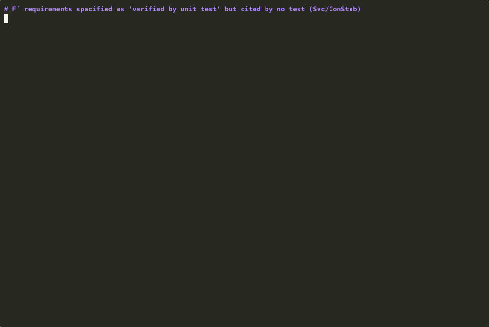
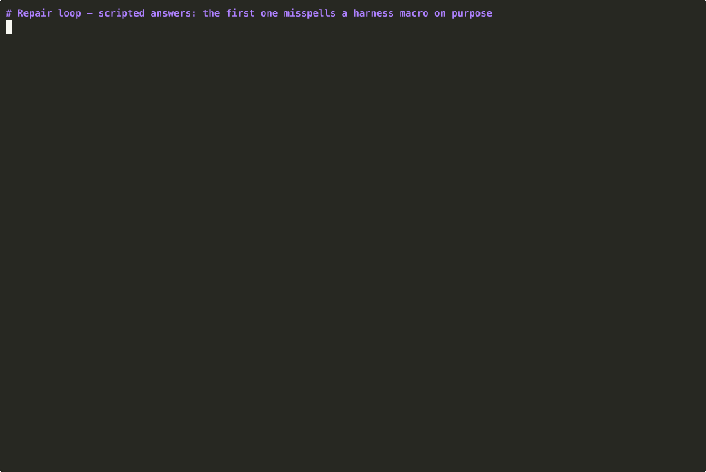
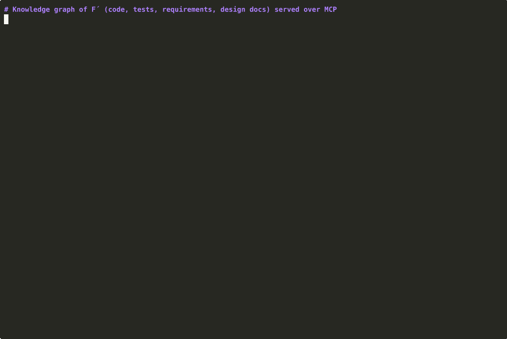
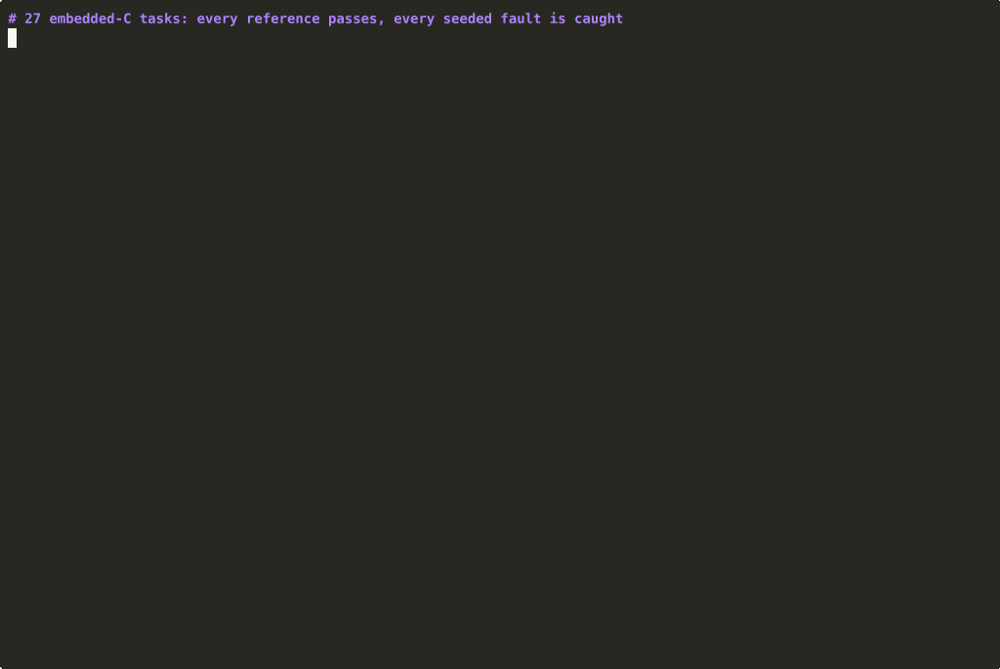
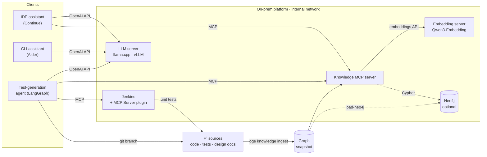

# onprem-genai-embedded

[](https://github.com/djihad-elhak/onprem-genai-embedded/actions/workflows/ci.yml)  

**A reference implementation of an on-premise GenAI platform for embedded / aerospace software teams —
sized, benchmarked and air-gap verified, with a requirements-aware code knowledge graph exposed to assistants
over MCP.**

[Français](README.fr.md) · [Architecture](docs/ARCHITECTURE.md) · [Design decisions](docs/DESIGN_DECISIONS.md) ·
[Agent](docs/AGENT.md) · [Evaluation suite](docs/EVALSUITE.md) · [Productivity & scale-up](docs/STRATEGY.md) ·
[Results](docs/results/README.md) · [Plan](docs/PLAN.md)

Target code base: **NASA F´ (F Prime) v4.4.1** — JPL's open-source flight-software framework (flown on the
Ingenuity Mars helicopter), Apache-2.0, ≈ 207 k lines of C++. Fetched at a pinned commit, never vendored.

---

## See it run



**The agent closes a traceability gap in F´.** Context comes over MCP; then the answer is policy-checked,
built with `fprime-util`, run 3 times plus the full suite, committed on a review branch, and graded on 4 mutants.
Everything is live except the model: its answer is **replayed** from Qwen3-Coder-30B-A3B's real output in
benchmark run 3, because the recording machine has no GPU ([how the demos are made](demo/README.md)).

| Repair loop (scripted mistake) | Knowledge graph over MCP | Evaluation suite |
|---|---|---|
|  |  |  |
| A misspelt harness macro fails the build; the error and a did-you-mean hint go back to the model, which fixes it. | What an assistant gets from the MCP server: a requirement, the gaps of a component, candidate tests, code and design docs. | 27 C tasks validate themselves; the two models measured on Kaggle, scored by execution. |

**Interactive replay.** Open [`demo/web/index.html`](demo/web/index.html) in a browser (one self-contained
file, no server) to step through three real agent runs (a repaired pass, a first-try pass, a failure) with
the exact compiler and test output, browse every attempt on all 28 requirements, and explore the benchmark
charts. It is built from the stored results by `demo/web/extract.py`.

## What it does

| Layer | Component | Status |
|---|---|---|
| **Sizing** | `oge sizing` — GPU memory (weights + KV cache + linear-attention state), roofline throughput incl. MoE expert traffic, team capacity planning; every datasheet value carries its source, unknown values are refused, not guessed | ✅ calibrated on 2× T4, validated against load tests |
| **Serving** | llama.cpp (CPU / CUDA) and vLLM profiles in Docker Compose, API keys, localhost-bound ports; `oge bench` load generator (TTFT, TPOT, throughput percentiles) with code-assistant traffic profiles | ✅ stack · 2×T4 sweeps (3 deployments) |
| **Knowledge** | Tree-sitter ingestion of code, unit tests, requirement tables and design docs into a typed graph (in-memory or **Neo4j**); hybrid BM25 + dense + graph retrieval | ✅ |
| **MCP** | Knowledge server (MCP SDK v2, stdio or streamable HTTP): `search`, `get_symbol`, `get_callers/callees`, `get_requirement`, `trace_requirement`, `coverage_gaps`, `module_overview` | ✅ |
| **Assistants** | Continue, Aider and generic MCP client configs targeting the platform | ✅ |
| **Air gap** | Compose overlay on an internal Docker network + smoke test that **fails if any outbound connection succeeds** | ✅ (CI) |
| **Model evaluation** | `oge eval` — 27 purpose-written embedded C tasks (generation, unit-test generation, refactoring, documentation) scored by execution: strict compile, hidden tests, ASan/UBSan, gcov coverage, mutation testing, complexity, Doxygen completeness; the suite validates itself | ✅ 2 models measured |
| **Agent** | `oge agent` — LangGraph agent that closes F´ traceability gaps: retrieves context over MCP, writes a requirement-tagged unit test, builds and runs it, repairs from compiler and test output, commits on a review branch; the model only writes test code, everything else is deterministic and policy-checked | ✅ 18/28 gaps closed per model (v2) |
| **CI** | Jenkins LTS with the official MCP Server plugin (least-privilege service account, JCasC); the agent triggers the F´ unit-test pipeline and reads the verdict over MCP | ✅ (CI) |

## Results

### What runs on 2× Tesla T4 (probe, 4-bit weights)

| Model | Engine | Decode tok/s, 1 stream | Prefill tok/s | Total tok/s, 4 streams | VRAM per GPU (GiB) | C smoke test |
|---|---|---|---|---|---|---|
| Qwen3-Coder-30B-A3B (MoE, 3.3 B active) | llama.cpp Q4_K_M | 81.9 | 1,445 | 151 | 9.9 / 9.3 | ✗ ¹ |
| Qwen3-Coder-30B-A3B | vLLM 0.32 AWQ | **101.0** | 283 | **245** | 13.4 / 13.4 ² | ✓ |
| Qwen3.6-35B-A3B (MoE, hybrid attention) | llama.cpp Q4_K_M | 60.9 | 1,326 | 107 | 10.8 / 10.3 | ✓ |
| Devstral-Small-2-24B (dense) | llama.cpp Q4_K_M | 15.9 | 649 | 28 | 8.4 / 8.1 | ✓ |
| Qwen3.8-27B (dense, hybrid attention) | llama.cpp Q4_K_M | 13.9 | 550 | 29 | 7.6 / 8.6 | ✓ |
| Qwen3.8-27B | vLLM 0.32 GPTQ (eager only) | 4.6 | 206 | 16 | 12.0 / 12.0 ² | ✓ |

On bandwidth-bound Turing GPUs, MoE models with ≈ 3 B active parameters decode 4–6× faster than dense 24–27 B
models. vLLM wins decode and concurrency on the MoE model but its AWQ prefill on SM 7.5 (no Marlin kernels) is 5×
slower than llama.cpp — decisive for 9k-token agent prompts. Qwen3.8 does not load in vLLM with AWQ at tensor
parallel 2 (quantized weight shape not aligned with the TP split) and runs out of memory with CUDA graphs in GPTQ.
¹ The model used `size_t` without `#include <stddef.h>`; ² vLLM pre-allocates 90 % of GPU memory.
Source: [`docs/results/probe/run2-2026-10-28.md`](docs/results/probe/run2-2026-10-28.md).

### Requirement → test traceability recovery (F´)

Ground truth: the 481 `REQUIREMENT("ID")` tags F´ developers placed in unit tests, linking **151 requirements**
to the tests that verify them. Tags and IDs are masked; each method ranks **all 3,261 test cases** of the code
base for every requirement. Mean over requirements, 95 % bootstrap CI.

| Method | MAP | MRR | Recall@1 | Recall@10 |
|---|---|---|---|---|
| Graph only (requirement's module, call edges) | 0.249 [0.220, 0.278] | 0.291 | 0.073 | 0.550 |
| BM25 over code (identifier-aware tokenizer) | 0.488 [0.427, 0.548] | 0.591 | 0.297 | 0.677 |
| Dense (Qwen3-Embedding-0.6B) | 0.479 [0.428, 0.531] | 0.586 | 0.261 | 0.713 |
| Graph-constrained BM25 | 0.569 [0.513, 0.626] | 0.665 | 0.330 | 0.781 |
| Graph-constrained dense | 0.573 [0.521, 0.619] | 0.680 | 0.303 | 0.817 |
| **Graph-constrained fusion of BM25 and dense (RRF)** | **0.609 [0.553, 0.660]** | **0.713** | **0.350** | **0.821** |
| + LLM rerank of the top 10 (Qwen3-Coder) | 0.584 [0.535, 0.633] | 0.670 | 0.297 | 0.822 |

No signal alone is enough: the graph knows *where* to look (requirements are allocated to components), the text
knows *which* test, and lexical and dense retrieval fail on different requirements. Pointwise LLM reranking
*lowered* precision at the top and costs 10 calls per requirement: not used by default. Sources:
[`traceability_lexical.json`](docs/results/traceability_lexical.json),
[`bench/run2-2026-10-28`](docs/results/bench/run2-2026-10-28/README.md).

### Code models on embedded C (`oge eval`, 27 tasks scored by execution)

| Model (Q4_K_M, llama.cpp, 2× T4) | Generate | Unit-test gen. | Refactor | Document | Tasks passed | Median latency |
|---|---|---|---|---|---|---|
| **Qwen3-Coder-30B-A3B** | **9 / 12** | 0 / 6 | 2 / 5 | **4 / 4** | **15 / 27** | **21 s** |
| Devstral-Small-2-24B | 5 / 12 | 1 / 6 | 2 / 5 | 2 / 4 | 10 / 27 | 85 s |

Qwen3-Coder passes more tasks (7 vs 2 discordant; exact McNemar p = 0.18 — a direction at this sample size) at a
quarter of the latency. Every failure was re-scored from the stored outputs; the patterns matter more than the
totals: **8 of 12 generated test programs fail on the correct implementation** because the model computed
expected values by hand (checksums, saturation bounds) — the valid ones kill 16 of 19 seeded faults; bit-level
conventions (COBS, Hamming(7,4), convolutional coding) defeat both models; refactorings always reduce complexity
but 4 of 10 change behaviour. Generated code and tests need execution gates, not review alone.

### Test-generation agent on F´ (28 requirement gaps)

| Model | Verified, v1 → v2 | First answer compiles, v1 → v2 | Mutants killed by verified tests (v2) | Median time / requirement |
|---|---|---|---|---|
| Qwen3-Coder-30B-A3B | 11 → **18 / 28** | 52 % → 81 % | 42 / 64 | 43 s |
| Devstral-Small-2-24B | 8 → **18 / 28** | 15 % → 67 % | 35 / 67 | 94 s |

v1 failed 121 attempts; classifying them (`failure_causes`) showed that **54 % came from one confusion the agent
itself reinforced**: calling `doDispatch()` on passive components, encouraged by a did-you-mean hint that offered
a method F´ v4 does not have. Another 8 came from a patcher bug. v2 states the component kind and the exact
dispatch call, fixes the bug, keeps the block a repair answer leaves out and shows the source of failed F´
assertions. On the same 28 requirements and models, verified tests went from 11 to 18 and from 8 to 18 (exact
McNemar p = 0.016 and 0.013); those failure causes dropped to zero. What remains is the models' knowledge of
the F´ API (invented enum values and include paths) and of component preconditions. An AI pre-review of the 36
verified tests finds 30 relevant and 6 partially relevant (to be confirmed by an engineer on the review sheets).
Source: [`bench/run3-2026-10-28`](docs/results/bench/run3-2026-10-28/README.md).

### Serving on 2× T4 (new prompts at every concurrency level)

| Deployment | Chat, 1 user | Chat, 4 users | Chat, 16 users | Agent step (9k-token prompt), 4 streams | Inline completion, 4 streams |
|---|---|---|---|---|---|
| Qwen3-Coder · llama.cpp (4 slots) | 74 tok/s · first token 2.3 s | 23 tok/s/user · 5.7 s | 20 tok/s/user · **71 s** (queued) | **0.31 req/s** · 4.1 s | first token 2.6 s |
| Qwen3-Coder · vLLM (TP 2) | 71 tok/s · 2.4 s | 27 tok/s/user · 6.8 s | 7 tok/s/user · 7.0 s | 0.13 req/s · 19.1 s | **first token 1.5 s** |
| Devstral · llama.cpp | 15 tok/s · 5.0 s | 6 tok/s/user · 11.2 s | 6 tok/s/user · 226 s | 0.14 req/s · 7.5 s | first token 4.4 s |

One 2× T4 server holds about four concurrent chat users at 20 tok/s each. On Turing, vLLM is the better engine
for interactive traffic and llama.cpp for long-context agent steps (vLLM's prompt processing lacks FlashAttention
2 and Marlin kernels there), so the choice depends on the workload mix and must be re-measured on the target GPU.

### Sizing: calibrated on these runs

Fitted on the probe, separately for dense and MoE models (decode 77 % vs 59 % of peak bandwidth on llama.cpp),
the sizing model predicts decode within ±11 % for a held-out model and within 4 % on the independent run 3. It
also predicts the chat capacity of one 2× T4 llama.cpp server within 7 % of the load test (0.187 vs 0.174
requests/s). Team tables for 25–400 engineers on L4 to H200, with the assumption they rest on:
[`docs/results/sizing`](docs/results/sizing/README.md) and [STRATEGY](docs/STRATEGY.md).

### Traceability audit of F´ (automatic, from the graph)

- **288 requirements** whose design document specifies verification by test have **no explicit test tag** —
  not necessarily untested (tagging is not systematic in F´), but without traceable evidence; each comes with
  suggested candidate tests for review ([`traceability_gaps.json`](docs/results/traceability_gaps.json)).
- **12 requirement IDs cited by tests are defined nowhere** (e.g. `ISF-HTH-001…007` in `Svc/Health` tests, while
  the design document defines `HTH-001…007`).
- **12 requirement IDs are cited by tests of a different component** (e.g. `PDB-*` of `Svc/PolyDb` tagged in
  `Svc/PrmDb` tests) — likely copy-paste. ([`traceability_audit.json`](docs/results/traceability_audit.json))

### Knowledge graph

1,250 source files · 206,656 LOC · 5,499 functions · 3,261 test cases · 560 requirements (from 83 design
documents) · 21,681 resolved call edges (incl. F´ autocoder conventions `sendCmd_X → X_cmdHandler`) —
built in ≈ 3 s on a laptop CPU.

## Quickstart

```bash
# 0. Get the code
git clone https://github.com/djihad-elhak/onprem-genai-embedded.git && cd onprem-genai-embedded

# 1. Knowledge graph + MCP server, no GPU, no Docker
uv sync --all-extras
scripts/fetch_fprime.sh                                     # pinned F´ v4.4.1
uv run oge knowledge ingest --audit-out artifacts/audit.json
uv run oge knowledge trace-eval                             # reproduces the table above
uv run oge mcp serve                                        # stdio MCP server for your IDE

# 2. Sizing
uv run oge sizing memory qwen3.8-27b --weights q4_k_m --gpu t4 --gpus 2 --context 65536
uv run oge sizing plan qwen3.8-27b --scenario chat_agents --engineers 100

# 3. Full platform (Docker): local LLM + embeddings + knowledge MCP server
cp deploy/.env.example deploy/.env && scripts/download_models.sh
docker compose -f deploy/compose.yaml --profile cpu up -d
uv run oge platform smoke --llm-url http://localhost:8080 --embed-url http://localhost:8081 \
    --mcp-url http://localhost:8765/mcp

# 4. Prove it runs air-gapped (internal network, egress probe must fail)
docker compose -f deploy/compose.yaml -f deploy/compose.offline.yaml --profile cpu --profile smoke \
    up --abort-on-container-exit --exit-code-from smoke
```

```bash
# 5. Evaluation suite and test-generation agent (no GPU needed for the demo)
uv run oge eval validate                                    # the suite checks itself
uv run oge eval run --reference                             # oracle answers → 100 %, proves the harness
scripts/setup_fprime_ut.sh                                  # F´ unit-test build (googletest, tools, cache)
uv run oge agent run --scripted tests/data/scripted_agent_answers.json -r SVC-COMSTUB-003
# with a served model and Jenkins (deploy/compose.ci.yaml):
uv run oge agent run --base-url http://localhost:8080 --label my-model \
    --ci-url http://localhost:8090/mcp-server/mcp --ci-user oge-agent --ci-token "$JENKINS_AGENT_PASSWORD"
```

GPU benchmarks run as batch notebooks on Kaggle (2× Tesla T4): `kaggle/00_probe_t4x2` (what runs on Turing
GPUs) and `kaggle/01_benchmark` (serving sweeps, dense/LLM traceability, sizing inputs, model evaluation
and agent runs, one model load per configuration).

## Architecture



Details: [docs/ARCHITECTURE.md](docs/ARCHITECTURE.md).

## Engineering

- Python ≥ 3.11, `uv`, ruff, pyright, pytest (unit, contract tests shared by the in-memory and Neo4j stores,
  live MCP-over-HTTP integration test, agent end to end on real F´); GitHub Actions: quality → F´ + Neo4j +
  agent integration → air-gapped deploy smoke → Jenkins over MCP.
- Reproducibility: pinned F´ commit, deterministic graph snapshots, every reported number produced by a command
  or notebook committed here, with its inputs recorded.
- No model API is called at runtime; all models are open weights served locally.

## Repository layout

```
src/onprem_genai/   sizing/  bench/  knowledge/  mcp_server/  platform/  evalsuite/  agent/  llm.py
kaggle/             GPU notebooks (probe, M1 benchmark)
deploy/             Dockerfile, compose (cpu/gpu/vllm/neo4j), offline overlay, Jenkins (compose.ci.yaml), clients
docs/               plan, architecture, design decisions, results
tests/              unit, contract and integration tests
```

## License

Apache-2.0. F´ is © Caltech/JPL, Apache-2.0, fetched at build time (see [NOTICE](NOTICE)). Open-weight models
are governed by their own licenses (Qwen, Devstral, DeepSeek: Apache-2.0 / MIT).
