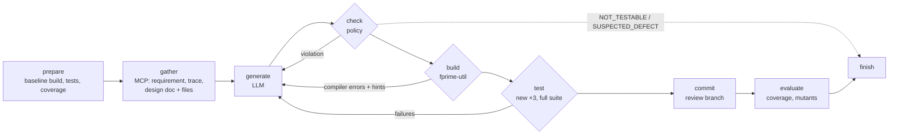

---
sources:
  - src/onprem_genai/agent/
  - src/onprem_genai/llm.py
  - deploy/compose.ci.yaml
  - deploy/jenkins/
  - scripts/setup_fprime_ut.sh
  - tests/test_agent.py
  - tests/test_agent_ci.py
  - tests/data/scripted_agent_answers.json
---

# Test-generation agent

The agent closes **traceability gaps** in NASA F´: requirements whose design document says *verified by unit
test* but that no test tags with `REQUIREMENT("…")`. For each gap it writes one unit test in the component's
existing gtest harness, builds and runs it, repairs its own mistakes, commits it on a review branch, and finally
has Jenkins run the component test suites on that branch, through MCP.

```bash
scripts/setup_fprime_ut.sh                                  # F´ checkout + googletest + tools + UT build cache
oge knowledge ingest                                        # knowledge graph (requirements, code, tests)
oge agent targets                                           # the 28 gaps of the default benchmark
oge agent run --scripted tests/data/scripted_agent_answers.json -r SVC-COMSTUB-003   # offline demo
oge agent run --base-url http://127.0.0.1:8080 --model default --label "Qwen3-Coder-30B-A3B" --mutants 4 \
              --ci-url http://127.0.0.1:8090/mcp-server/mcp --ci-user oge-agent --ci-token "$TOKEN"
```

## Design



The graph is a LangGraph `StateGraph` (`agent/graph.py`). The key decision is **bounded authority**: the model
writes only test code; everything else is a deterministic node whose arguments come from the requirement, never
from model output.

| Concern | How it is handled |
|---|---|
| What the model writes | New `Tester` member functions and `TEST()` cases, in two fenced blocks. Declarations, insertion points (tree-sitter anchors in `Tester.hpp`, `Tester.cpp`, `TestMain.cpp`) and includes are derived by `agent/patch.py`. |
| Files it may touch | Only the three test files of the target component; enforced structurally (the patcher writes nothing else) and checked in the end-to-end test. |
| Traceability | `REQUIREMENT("<id>")` is required and inserted if missing; tagging any other requirement is rejected. |
| Unsafe code | `system`, `popen`, `fork`, `exec*`, `exit`, `abort`, threads, inline assembly, preprocessor definitions, skipped or disabled tests are rejected before building. |
| Weak tests | At least one assertion; the new test is run 3 times (F´ tests use random seeds) and must not break any existing test. |
| Context | Deterministic and budgeted (≈36k characters): requirement, design-document excerpt (MCP `search`), FPP model, autocoded harness API (assertion macros, `invoke_to_*`, `sendCmd_*`), tester header, test main, related tests (MCP `trace_requirement`), implementation. Same context for every model. |
| Repair | Up to 3 attempts. Compiler errors are condensed with repo-relative paths; unknown identifiers get *did-you-mean* hints from the harness API and headers and their definitions over MCP (`get_symbol`); gtest failures and regressions are fed back verbatim. |
| Honest outcomes | `passed`, `not_testable` (the model may decline with a reason, e.g. verified by inspection), `suspected_defect` (the model claims the implementation violates the requirement — never committed, reported for review), `failed` (policy / build / test / regression). |
| Review | One branch per run, one commit per requirement, author `oge-agent (<model>)`, message with the requirement text and an AI-use disclosure (as F´'s `AI_POLICY.md` asks of contributions). A review sheet lists every test for a human verdict. |
| CI | After the batch, `JenkinsCi` triggers the `fprime-unit-tests` pipeline for the branch over the Jenkins MCP server and records the verdict and JUnit counts. |

The agent follows F´'s own unit-testing guidance (`.github/skills/fprime-unit-testing` in the F´ repository):
test through ports and commands, `clearHistory()` before the checked action, `doDispatch()` for active
components, derive expectations from requirements, no internals.

## Metrics

| Metric | Definition |
|---|---|
| Verified rate | `passed / attempted` (unsupported components and broken baselines excluded) |
| First-attempt compile rate | share of requirements whose first answer compiled |
| Attempts when verified | mean number of LLM answers for verified requirements |
| Coverage delta | component implementation line coverage (gcov) after − before, per commit |
| Fault detection | the new test alone is run against up to N mutants of the implementation lines it executes (inverted conditions, off-by-one bounds, swapped `SUCCESS`/`FAILURE`/`OK` statuses, deleted port calls, events and telemetry writes); mutants that do not compile are discarded; score = killed / valid. The agent never sees this. |
| Relevance | human verdict per test on the review sheet (relevant / partial / not relevant) |
| Cost | LLM calls, tokens, wall time per requirement |

Coverage delta is reported but is a weak signal here: the default components are already well covered, and
a test that verifies a requirement can execute lines that other tests already execute. Fault detection is the
stronger automatic signal; relevance still needs a human.

## Default benchmark

`oge agent targets` lists 28 gaps in four components: `Svc/ComStub` (7), `Svc/ComRetry` (7), `Svc/PrmDb` (5) and
`Svc/FprimeRouter` (9). They were chosen because they have the standard `Tester` / `TestMain` harness, build and
pass at baseline, and have no requirement-ID mismatch in the traceability audit (e.g. `Svc/Health` tests tag
`ISF-HTH-00x` while its document defines `HTH-00x`: that gap is a labelling problem, not a missing test).

## Jenkins over MCP

`deploy/compose.ci.yaml` runs Jenkins 2.568.3 LTS with the official [MCP Server
plugin](https://plugins.jenkins.io/mcp-server/) (`mcp-server`), configured as code (`deploy/jenkins/casc.yaml`):

- service account `oge-agent` with **Overall/Read, Job/Read, Job/Build only** (the plugin filters its tool list by
  permission, so the agent cannot reach administrative tools);
- pipeline `fprime-unit-tests` (parameters `BRANCH`, `MODULES`) cloning the agent's branch from the read-only F´
  mount, building each component's unit tests and publishing JUnit reports (`FAILURE` = build error, `UNSTABLE` =
  failing test);
- tools used by the agent: `getJob`, `triggerBuild`, `getQueueItem`, `getBuild`, `getTestResults`, `getBuildLog`,
  with HTTP Basic authentication (API token or password).

The client is tested against a fake of the plugin (same tool names, parameters and JSON envelope, taken from the
plugin source); the CI job `jenkins-integration` runs the real stack: agent run with the scripted model, then the
Jenkins verdict over MCP.

## Limits

- One test per requirement, written in the existing harness: rule-based (STest) scenarios and new helpers shared
  between tests are out of scope.
- `suspected_defect` answers are model claims; they are reported, never acted on.
- Components with non-standard harnesses (several testers, no `TestMain`) are reported `unsupported`.
- Pass rates on 28 requirements are indicative; compare models on the same branch base and context budget.
