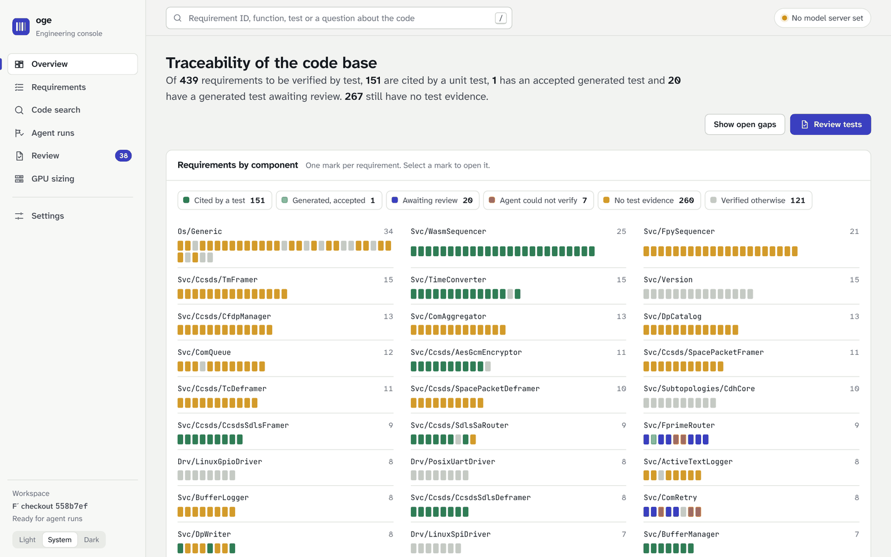
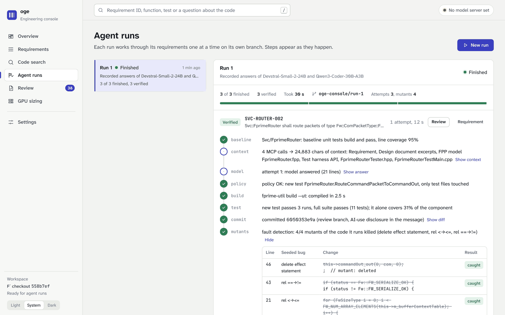

---
sources:
  - src/onprem_genai/console/
  - tests/test_console.py
  - deploy/Dockerfile
  - deploy/compose.yaml
---
# Engineering console

The console is the web application engineers use on site. It puts the platform's parts behind one interface:
where the code base stands on traceability, what the code does, generated tests waiting for a person, and how
many GPUs a team needs. It runs next to the model servers, loads no asset from the internet, and keeps its state
in one SQLite file.



## What engineers do with it

| Page | Job | Built on |
|---|---|---|
| **Overview** | See every requirement of the design documents as one mark, coloured by its evidence: cited by a test, generated test awaiting review or accepted, agent could not verify, no evidence, verified otherwise. Select a mark to open the requirement. | knowledge graph, console results |
| **Requirements** | Filter by component and state, open a requirement to see its text, rationale, source, the tests that cite it, the candidate tests ranked by the traceability model and the related implementation; select gaps and generate tests. | `trace_requirement`, catalog |
| **Code search** | Search functions, tests, requirements and design documents by meaning and by name; open a symbol to read its source and walk its callers and callees. | hybrid search, call graph |
| **Agent runs** | Start a run on chosen gaps and watch each step as it happens: context, model answer, policy check, compiler output, test output, commit, seeded bugs. Stop after the current requirement. | LangGraph agent, server-sent events |
| **Review** | Judge each verified test against its requirement (relevant, partial, not relevant; keys 1, 2, 3; j and k to move), with the test code, its diff, the mutants it caught and missed, and how it got there. Export the review sheet. | results + verdicts |
| **GPU sizing** | Change the model, quantization, team size, request mix, speed target and efficiency source; read the smallest deployment per GPU type. | calibrated sizing model |
| **Settings** | Point agent runs at any OpenAI-compatible server (llama.cpp, vLLM, a gateway) and test it; sign verdicts. | |



## Run it

```bash
uv sync --extra console
scripts/setup_fprime_ut.sh                       # F´ checkout + unit-test build: enables agent runs
uv run oge knowledge ingest                      # knowledge graph
uv run oge console serve --fprime third_party/fprime    # http://127.0.0.1:8770
```

Without `--fprime` everything works except agent runs. In this repository the console imports the 56 agent
results of benchmark run 3 (both models) for review, with the AI pre-review shown as a suggestion, and can
replay the 20 recorded answers that are self-contained, so a run works without a model server; the build,
tests, commit and mutants still run for real.

With Docker, next to the model servers:

```bash
docker compose -f deploy/compose.yaml --profile cpu --profile console up -d     # or --profile gpu / vllm
```

The `console` image (`deploy/Dockerfile`, target `console`) adds a C++ toolchain and an F´ checkout prepared
for unit-test builds. The review branches live in the `console-fprime` volume and the database in
`console-data`. Set the model server in Settings: inside the Compose network it is `http://llm:8080` with the
`OGE_API_KEY` of `deploy/.env`.

## How a run works

1. `POST /api/runs` checks every requirement: it must be a gap and its component must have the standard
   `Tester` / `TestMain` harness.
2. Runs share one F´ working copy, so they wait in a queue and run one at a time. Each starts from the base
   commit (the checkout's `HEAD` when the console first started) on its own branch, `oge-console/run-<id>`.
3. The agent streams one event per graph step. The console stores each event, so a finished run can be
   reopened, and pushes it to browsers over server-sent events. A browser that reconnects asks for the
   events after the last one it saw.
4. Each finished requirement becomes a result. Verified ones enter the review queue; a verdict of relevant or
   partial turns the requirement's mark into "generated, accepted".
5. A stop request lets the current requirement finish, so no half-applied edit is ever left in the checkout.

Recorded answers are replayed only when they are self-contained (both the Tester and the TEST blocks). A repair
answer may resend only the block it changed, because the agent reuses the other block from the previous
answer, and such an answer cannot pass on its own.

## Security

- Listens on 127.0.0.1 by default; the Compose service publishes on the host's loopback only. To share it,
  put it behind the site's reverse proxy and its authentication.
- The model server's API key is write-only: stored server-side, never returned by the API (tested).
- Strict Content-Security-Policy (`default-src 'self'`, no inline script), `nosniff`, no referrer; fonts and
  scripts are served from the package, so the console works on an air-gapped network.
- The agent keeps its bounded authority (see [AGENT.md](AGENT.md)): only test files of one component, on a
  branch, after policy, build and test gates.

## API

| Method and path | Purpose |
|---|---|
| `GET /api/status` | graph size, workspace readiness and problems, model server, replayable answers, queue |
| `GET /api/overview` | counts by state, requirement marks per component, review queue size, recent runs |
| `GET /api/modules`, `GET /api/requirements?module=&state=&q=` | catalog |
| `GET /api/requirements/{id}` | requirement, evidence (`trace_requirement`), agent results, agent eligibility |
| `GET /api/search?q=&kind=&module=&k=`, `GET /api/nodes/{id}` | hybrid search; symbol with callers and callees |
| `GET/PUT /api/settings`, `POST /api/settings/test` | model server (API key write-only), reviewer; test request |
| `POST /api/runs`, `GET /api/runs`, `GET /api/runs/{id}` | start (`req_ids`, `model_kind` endpoint or replay, `attempts`, `mutants`), list, detail with events |
| `GET /api/runs/{id}/events?after=` | server-sent events |
| `POST /api/runs/{id}/stop` | cancel a queued run, or stop a running one after its current requirement |
| `GET /api/reviews?filter=`, `GET/PUT /api/reviews/{id}`, `GET /api/reviews/export` | review queue, verdicts, Markdown review sheet |
| `GET /api/sizing/options`, `POST /api/sizing/plan` | sizing catalogue; best deployment per GPU type with workload overrides |

## Design

- **Stack.** Starlette, uvicorn and sse-starlette, which the MCP SDK already depends on, so the console adds
  no new runtime dependency. The front end is Preact with htm, vendored as one 13 kB ES module: no build step,
  no Node.js in the image, nothing fetched at run time.
- **Look.** Calm document greys; one indigo, the colour of a review pen, for everything that needs a person;
  a fixed set of traceability colours, always shown with a label. Atkinson Hyperlegible Next for text, chosen
  for legibility, and JetBrains Mono, with ligatures off, so code reads exactly as written. Light and dark
  themes, keyboard shortcuts, visible focus, reduced motion respected, usable on a phone.
- **Tests.** `tests/test_console.py` covers the API, persistence and settings validation. On real F´ (marker
  `fprime`) a run is started from the API and replays a recorded answer through the real build, tests, commit
  and mutation analysis. The CI job `console-image` builds the image and runs the agent inside it.

## Limits

- One shared F´ working copy, so runs are serialized. A site with many concurrent users would give each
  console worker its own checkout.
- No user accounts: the reviewer name is a setting. Identity belongs to the site's proxy (SSO).
- Coverage of the generated test is shown, but mutation results come from a sample (4 mutants by default).
